Single-cell multiome analysis with MultiVI
==========================================

Immune cells in blood differ in the genes they express and in which regulatory
regions of their chromatin are open. A single-cell multiome experiment measures
both in the same nucleus. This tutorial uses a public sample of peripheral
blood mononuclear cells (PBMCs) from one healthy donor to ask which cell
identities each measurement shows on its own, and what a model that combines
them adds.

In this paired sample, the joint MultiVI clustering adds no clearly new cell
state. Its two candidates, divisions of CD4 T cells that differ in markers as
well as in chromatin depth, need confirmation. MultiVI is designed for a
different use: it places both measurements in one coordinate system, so that
nuclei measured in only one modality can be placed in it too. Its clusters need
the same depth and marker checks as any single-measurement clustering.

The evidence, from 2,718 nuclei:

* Clustered separately, RNA and chromatin each largely keep together the six
  broad populations named in the joint analysis, and each separates naive CD4,
  naive CD8, and memory CD4 T cells.
* The clearest extra division made by the joint model follows chromatin depth.
  CD14 monocytes split into groups with about three-fold different ATAC
  fragment counts and no detectable expression difference other than two
  mitochondrial-derived transcripts.
* The joint clustering merges two small groups that RNA alone keeps apart: 38
  nuclei with conventional dendritic cell (DC) markers and 27 with regulatory
  T-cell markers.
* The monocyte split and the two merges recur across four training seeds,
  although individual joint clusters vary.

The fully rendered notebook and reproducibility files are available here:

* :download:`Rendered Jupyter notebook <multiome_tutorial/notebooks/multiome_multivi_tutorial.ipynb>`
* :download:`Conda environment <multiome_tutorial/environment.yml>`
* :download:`Data download script <multiome_tutorial/scripts/download_data.sh>`
* :download:`Fragment QC script <multiome_tutorial/scripts/prepare_fragment_metrics.sh>`
* :download:`Multiome workflow <multiome_tutorial/scripts/multiome_workflow.py>`
* :download:`Complete analysis runner <multiome_tutorial/scripts/run_multivi.py>`
* :download:`Seed check <multiome_tutorial/scripts/seed_check.py>`
* :download:`Notebook builder <multiome_tutorial/scripts/build_notebook.py>`

Learning objectives
-------------------

By the end of this tutorial, you should be able to:

* identify the Cell Ranger ARC files used for secondary multiome analysis;
* calculate RNA and ATAC quality metrics separately for the same nuclei;
* summarize which nuclei have usable RNA, usable ATAC, both, or neither;
* keep raw counts for modeling and normalized values for plots;
* build an RNA-only and an ATAC-only baseline for comparison;
* register a MuData object and train, save, and reload paired MultiVI;
* audit the joint representation against technical covariates;
* compare what RNA, ATAC, and the joint model each resolve in the same nuclei;
* keep observed expression, observed accessibility, and model output apart.

Dataset and inputs
------------------

The example is the 10x Genomics `PBMC from a healthy donor, no cell sorting
(3k) <https://www.10xgenomics.com/datasets/pbmc-from-a-healthy-donor-no-cell-sorting-3-k-1-standard-2-0-0>`_
multiome dataset. Gene expression and chromatin accessibility were measured in
the same 3,009 called nuclei and processed by 10x with Cell Ranger ARC 2.0.0
against GRCh38 (reference ``2020-A``). Cell Ranger ARC called 81,156 accessible
peaks.

The workflow uses:

``filtered_feature_bc_matrix.h5``
   Gene and peak counts for called nuclei in one matrix. ``feature_types``
   separates ``Gene Expression`` from ``Peaks``.

``per_barcode_metrics.csv``
   RNA and ATAC metrics for every barcode, including background barcodes. In
   this ARC 2.0.0 output ``gex_umis_count`` is zero for every barcode; exonic
   plus intronic UMIs equal the matrix totals and are used instead.

``atac_peak_annotation.tsv``
   Positional peak annotations supplied by 10x. A peak is labelled a promoter
   peak for a gene by position, which does not establish that it regulates
   that gene.

``atac_fragments.tsv.gz`` and ``atac_fragments.tsv.gz.tbi``
   Barcoded fragments and their Tabix index, about 540 MB, used for fragment
   periodicity and nucleosome signal.

Environment and data download
-----------------------------

Create the environment, download the public inputs, and run the analysis:

.. code-block:: bash

   cd source/transcriptomics/multiome_tutorial
   conda env create -f environment.yml
   conda activate gencore-multiome-multivi

   scripts/download_data.sh
   scripts/prepare_fragment_metrics.sh
   python scripts/run_multivi.py

The raw downloads and trained model are ignored by Git. The notebook, scripts,
environment, and rendered figures remain versioned. The rendered model trained
on one CPU thread at about 1.9 seconds per epoch.

.. note::

   The scripts and notebook set ``OMP_NUM_THREADS=1`` and import Scanpy before
   scvi-tools. On macOS the PyTorch and scikit-learn wheels each bundle an
   OpenMP runtime. In this environment, MultiVI training stalled after Scanpy's
   neighbor and UMAP steps unless OpenMP was limited to one thread, and
   importing scvi-tools (and with it PyTorch) before Scanpy made numba's
   parallel QC code crash.

1. Cell Ranger ARC calls nuclei from both measurements
-------------------------------------------------------

Cell Ranger ARC separates nuclei from empty droplets using RNA UMIs and ATAC
fragments together. Most of the 3,009 called nuclei sit well above the
background barcodes on both axes, but a few are low on one of them: 14 have
fewer than 100 RNA UMIs, and the lowest has 29 ATAC fragments. They are kept for now, because
the next steps judge each measurement separately.

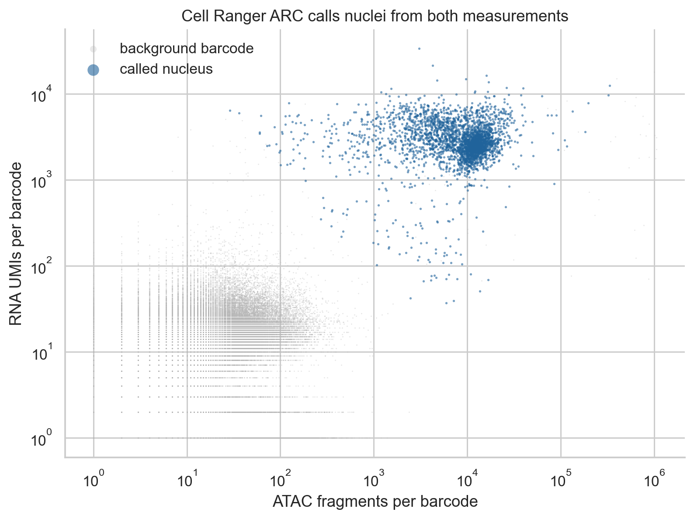

   RNA UMIs against ATAC fragments for every barcode in
   ``per_barcode_metrics.csv``. Called nuclei are blue; background barcodes are
   grey.

The fragment-length distribution of called nuclei has a large nucleosome-free
component below 147 bp and a mono-nucleosomal component between 147 and 294 bp,
with only a weak shoulder above 300 bp. The roughly 10 bp oscillations follow
the helical turn of DNA.

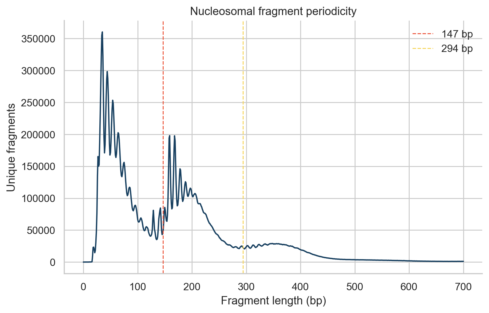

   Fragment lengths for called nuclei. Dashed lines mark 147 and 294 bp.

.. code-block:: python

   rna, atac, barcode_metrics = load_multiome_dataset(raw_dir, processed_dir)
   assert rna.obs_names.equals(atac.obs_names)

2. RNA and chromatin quality are judged separately
---------------------------------------------------

Each measurement gets its own review flags, so a nucleus can pass in one and
fail in the other:

* **RNA:** UMIs, detected genes, and the percentage of mitochondrial UMIs.
  Scrublet scores each droplet for RNA doublets. The intronic UMI fraction is
  shown for reference; its median of 0.43 reflects unspliced nuclear RNA, which
  Cell Ranger ARC counts.
* **ATAC:** high-quality fragments, the fraction of fragments in peaks (FRiP),
  the fraction of fragments near transcription start sites (TSS fraction), and
  nucleosome signal (mono-nucleosomal over nucleosome-free fragments).

The thresholds reuse the starting rules of the two single-measurement
tutorials: the 2.5th percentile for RNA depth and detected genes and the
97.5th for mitochondrial UMIs, as in the scRNA tutorial; the 1st percentile for
FRiP and TSS fraction, the 99th for nucleosome signal, and the 99.5th for
upper depth, as in the scATAC tutorial. Here the 99.5th percentile is used for
upper depth in both modalities, and ATAC depth uses the same 2.5th percentile
floor as RNA depth. They are review thresholds for this dataset, not universal
cutoffs.

.. list-table:: Review thresholds calculated from this dataset
   :header-rows: 1

   * - Metric
     - Flag when
   * - RNA UMIs
     - below 480 or above 9,880
   * - Detected genes
     - below 250
   * - Mitochondrial UMIs
     - above 27.5%
   * - ATAC fragments
     - below 470 or above 49,790
   * - FRiP
     - below 0.32
   * - TSS fraction
     - below 0.26
   * - Nucleosome signal
     - above 1.26

.. warning::

   ``tss_fraction`` is the fraction of fragments near annotated TSSs. It is not
   the TSS enrichment score, which is calculated from a TSS-centered insertion
   profile.

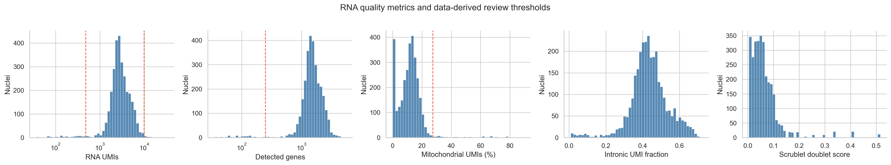

   RNA quality metrics with the thresholds above (dashed lines). The UMI
   distribution has a small low-depth tail: 77 called nuclei have fewer than
   500 UMIs.

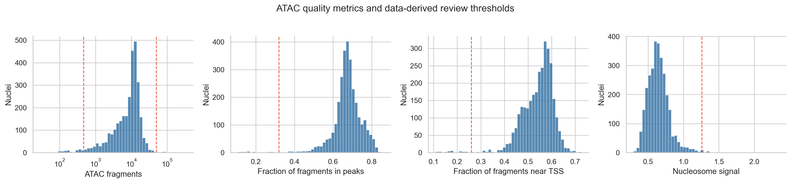

   ATAC quality metrics with the thresholds above.

.. code-block:: python

   score_doublets(rna, seed=17)
   thresholds = choose_qc_thresholds(rna.obs)
   add_qc_flags(rna.obs, thresholds)

3. Most nuclei contribute both measurements; nuclei with poor RNA often keep usable chromatin
-------------------------------------------------------------------------------------------------

Combining the flags gives four groups. Scrublet predicted 74 doublets. A
doublet droplet holds two nuclei, so these are excluded from the paired model
whatever their per-modality flags.

.. list-table:: Which measurements each called nucleus can contribute
   :header-rows: 1

   * - Group
     - Nuclei
     - Of which predicted doublets
   * - Both pass
     - 2,785
     - 67
   * - RNA only
     - 102
     - 2
   * - ATAC only
     - 103
     - 5
   * - Neither
     - 19
     - 0

The paired model uses the 2,718 nuclei that pass both and are not predicted
doublets.

The ATAC-only nuclei have a distinctive RNA profile. Their median is 320 UMIs,
32% of them mitochondrial, with an intronic fraction of 0.17 against 0.43 for
all called nuclei. Their chromatin is not worse than that of nuclei passing
both (median FRiP 0.72 against 0.67; TSS fraction 0.59 against 0.56), although
their median fragment count is lower (4,431 against 10,153). This combination
suggests nuclei whose own RNA was lost or diluted during isolation, rather than
empty droplets. The RNA-only nuclei show the reverse: typical RNA
(median 2,891 UMIs) but a median of 345 ATAC fragments.

These nuclei are not used here, but their flags are kept. An analysis that
mixes paired and single-modality nuclei could use the measurement that passed.

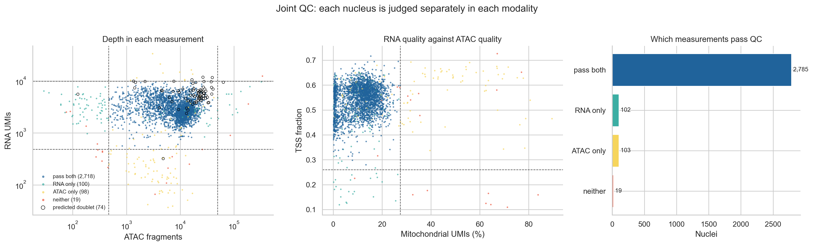

   Left: depth in each measurement, colored by which measurements pass;
   predicted doublets are circled. Middle: RNA mitochondrial fraction against
   ATAC TSS fraction. Right: counts per group.

.. code-block:: python

   retention_table(rna.obs)
   rna_paired, atac_paired = subset_paired(rna, atac)

4. Features for the model, and a baseline for each measurement
---------------------------------------------------------------

The model and the baselines use the same features:

* **Genes:** the 3,000 most variable genes by the Seurat v3 rule on raw counts.
  Mitochondrial genes and their nuclear ``MTRNR2L`` copies are excluded first.
  Mitochondrial transcripts are not nuclear expression, and the ``MTRNR2L``
  copies track each nucleus's mitochondrial fraction here (section 9). How much
  of either a nucleus carries likely depends on how cleanly it was isolated.
* **Peaks:** 64,305 peaks are detected in at least 30 of the 2,718 nuclei. The
  30,000 of them with the largest binary accessibility variance are kept.
  Feature selection is a reported choice because it changes what the model can
  represent.

Two baselines show what each measurement resolves without the other. The RNA
baseline is PCA (30 components) on scaled, log-normalized expression. The ATAC
baseline is TF-IDF followed by latent semantic indexing (LSI, 30 components) on
the same peaks. The first LSI component correlates 0.99 with log10 fragment
count, so it is dropped as a depth axis. The same neighbor graph (20 neighbors,
cosine distance), UMAP, and Leiden settings (resolution 0.8) are used for every
representation. Resolution 0.8 is a fixed choice, set before looking at the
results and not tuned, and the same value can give different numbers of
clusters on different representations. Here it gives 14 RNA-only clusters and
10 ATAC-only clusters.

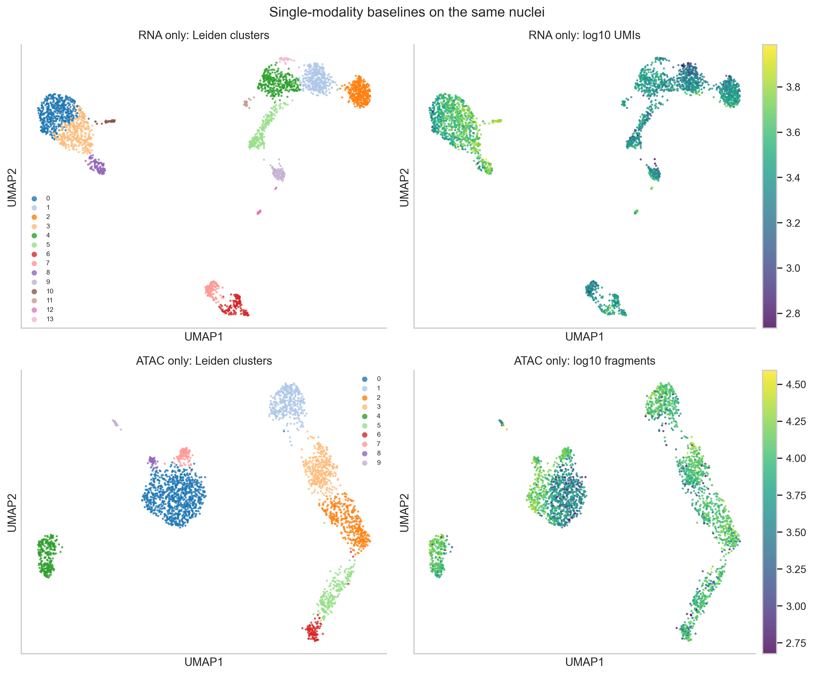

   RNA-only (top) and ATAC-only (bottom) embeddings of the same nuclei, colored
   by their own Leiden clusters and by depth.

.. code-block:: python

   genes = select_rna_features(rna_paired, n_top_genes=3_000)
   peaks = select_atac_features(atac_paired, min_cells_per_peak=30, max_peaks=30_000)
   normalize_rna(rna_paired)
   container.obsm["X_pca_rna"] = rna_baseline(rna_paired, genes)
   container.obsm["X_lsi_atac"], lsi_depth = atac_baseline(atac_paired, peaks)

5. MultiVI is trained on raw counts after a missing-modality check
-------------------------------------------------------------------

MultiVI learns one latent representation per nucleus from both measurements.
It treats a nucleus whose counts in a modality sum to zero as unmeasured in
that modality. Every nucleus here was measured in both, so after feature
selection each must still have counts in both. None has zero counts. The
minimum is 60 RNA UMIs across the 3,000 genes and 479 ATAC counts across the
30,000 peaks.

.. code-block:: python

   mdata = build_multivi_input(rna_paired, atac_paired, genes, peaks)
   check_observed_libraries(mdata)

   scvi.model.MULTIVI.setup_mudata(
       mdata,
       modalities={"rna_layer": "rna", "atac_layer": "atac"},
   )
   model = scvi.model.MULTIVI(
       mdata,
       n_genes=mdata["rna"].n_vars,
       n_regions=mdata["atac"].n_vars,
   )
   model.train(max_epochs=500, early_stopping=True, accelerator="cpu", devices=1)
   mdata.obsm["X_multivi"] = model.get_latent_representation()

All nuclei come from one paired sample, so no ``batch_key`` is passed. When
paired and single-modality nuclei are combined, the scvi-tools MultiVI tutorial
asks for the main ``batch_key`` to be the modality, with other batches passed as
``categorical_covariate_keys``. The scvi-tools defaults gave 128 hidden units
and 11 latent dimensions. Early stopping on the validation reconstruction loss
(patience 50 epochs) ended training at epoch 377; the best validation
reconstruction loss was at epoch 327.

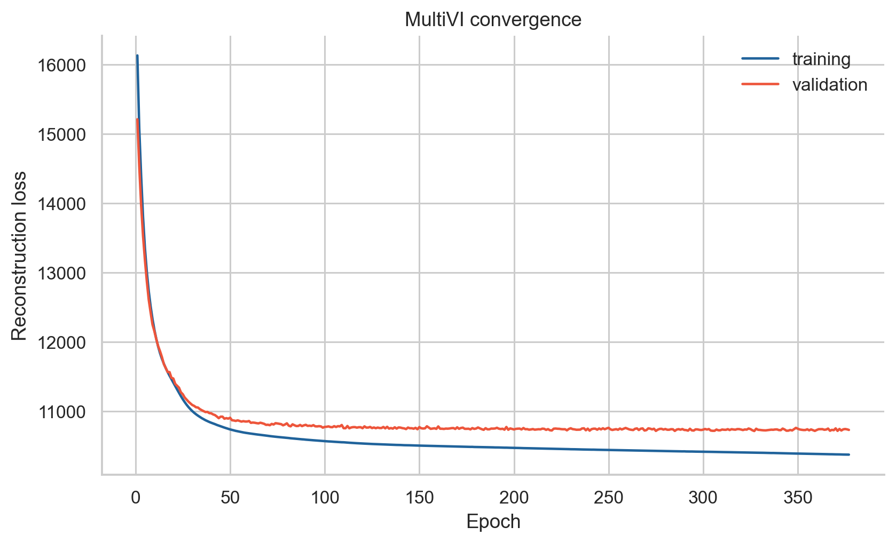

   MultiVI convergence. Training loss alone does not show that the
   representation is biologically meaningful.

6. One latent dimension tracks ATAC depth within cell types
------------------------------------------------------------

We correlated each latent dimension with RNA and ATAC quality metrics. Across
all nuclei, the strongest association is between dimension 3 and TSS fraction
(Pearson r = -0.70), and dimensions 3 and 6 correlate with RNA depth (\|r\|
about 0.5). Much of this reflects cell type: monocytes have more RNA UMIs and a
lower TSS fraction than lymphocytes. After removing each population's mean from
both variables, dimension 3 keeps r = -0.42 with TSS fraction, but its
correlation with RNA depth falls to 0.10. Dimension 9 is the one that tracks
ATAC depth and quality among nuclei of the same type (r = -0.54 with log10
fragments, 0.48 with TSS fraction, and 0.45 with FRiP). Clusters therefore need
to be checked against ATAC depth before they are interpreted.

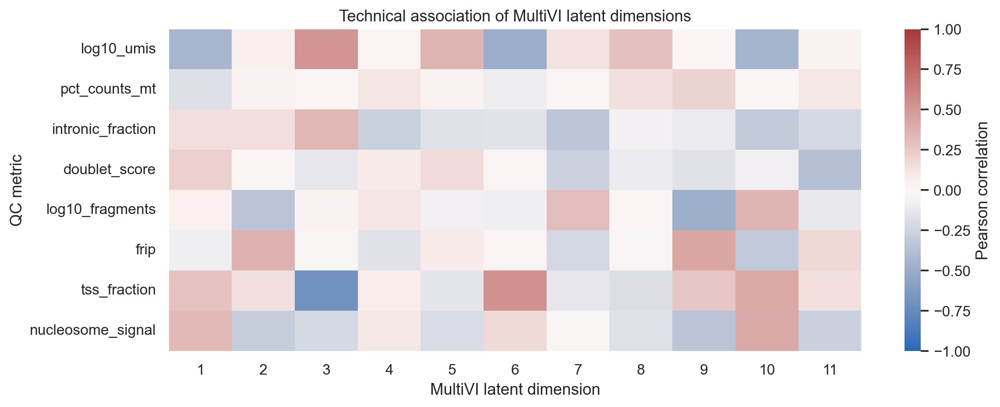

   Pearson correlations between each MultiVI dimension and RNA and ATAC QC
   metrics.

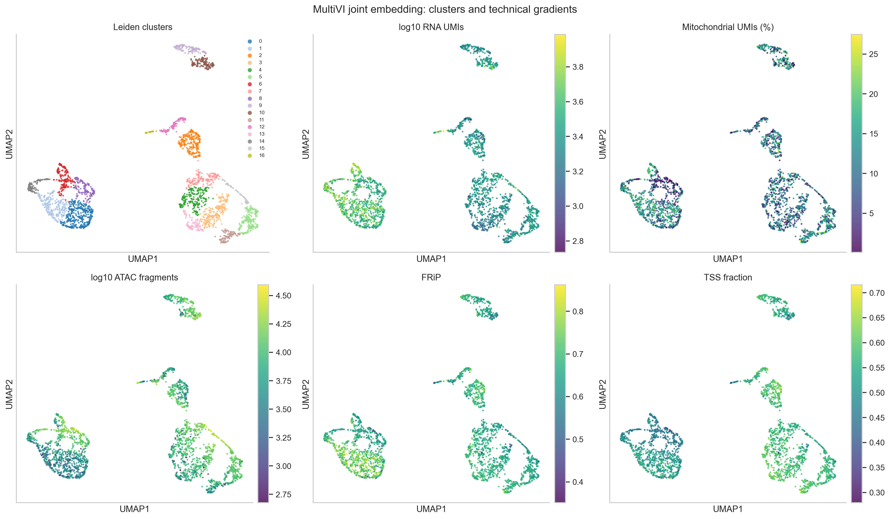

   The joint UMAP colored by Leiden cluster (17 clusters) and by QC metrics.
   ATAC depth varies within the monocyte region (left), which section 9
   examines.

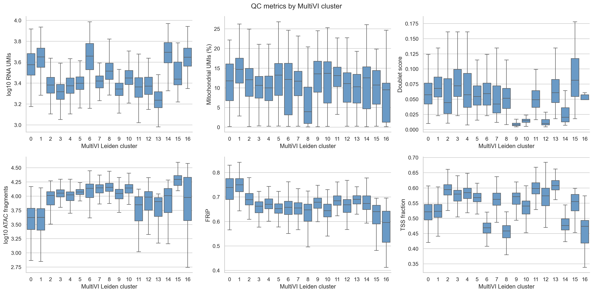

   QC metrics by joint cluster.

7. RNA markers name six broad populations; chromatin agrees most clearly for B cells and plasmacytoid DCs
---------------------------------------------------------------------------------------------------------

Each joint cluster is scored with several markers per broad PBMC population on
observed, log-normalized RNA. A cluster takes the best-scoring population when
that score is at least 0.3 and leads the runner-up by at least 0.2; otherwise it
stays ``Unresolved``. All 17 joint clusters met this rule: 1,074 T cells, 902
CD14 monocytes, 342 NK cells, 269 B cells, 102 FCGR3A monocytes, and 29
plasmacytoid dendritic cells (pDCs).
The labels are provisional names supported by marker evidence. Section 9 shows
two small groups that this rule cannot see.

Accessibility was not used to assign the labels, although it did shape the
joint clusters that were labelled. The ATAC panel below shows, for the same
marker genes, the fraction of nuclei with at least one fragment in a peak that
10x annotates as the gene's promoter.

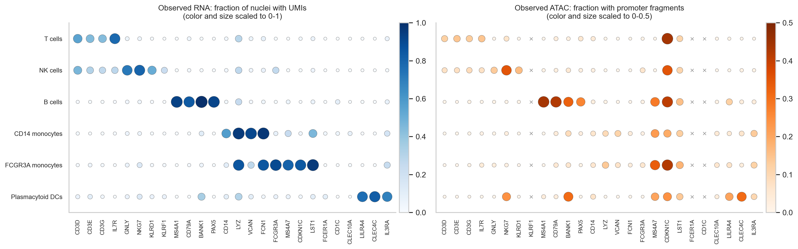

   Left: fraction of nuclei with UMIs for each marker. Right: fraction with a
   fragment in the gene's annotated promoter peaks (x: no annotated promoter
   peak). The panels use different color scales.

Promoter accessibility is sparse in single nuclei, so its values are lower
than RNA detection, and it supports the labels unevenly:

* **B cells:** MS4A1 and CD79A promoters are accessible in 44% and 42% of B
  cells and in at most 5% of any other population.
* **pDCs:** the CLEC4C promoter is accessible in 31% of pDCs and in at most 6%
  elsewhere.
* **T and NK cells:** CD3D, CD3E, and CD3G promoters reach 12–14% in T cells
  against at most 9% elsewhere; the NKG7 promoter reaches 35% in NK cells, but
  also 24% in pDCs.
* **Monocytes:** accessibility is low at all four CD14 monocyte marker
  promoters (at most 14% in any population). LYZ and VCAN promoters are
  accessible in 7–14% of monocytes and in at most 1% of other populations;
  CD14 and FCN1 promoters barely differ between populations.

To look beyond promoters, the next figure shows, for each population, the
marker locus whose most population-specific peak within 20 kb of the TSS
differs most from every other population. The table
``marker_locus_specificity`` in the results reports this value for every
marker, including those not shown. Among the loci shown, the most specific are
MS4A1 (B cells, 0.40), IL7R (T cells, 0.22), and CLEC4C (pDCs, 0.19). The
monocyte markers reach at most 0.05. For the two monocyte loci shown, VCAN and
MS4A7, at most 16% of the population's nuclei have a fragment in the most
specific peak, which caps how specific it can be.

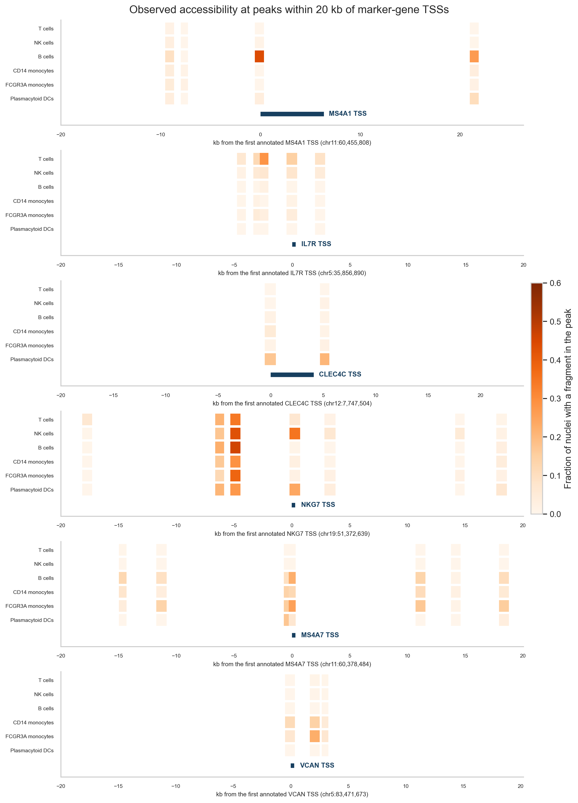

   Fraction of nuclei in each population with a fragment in each peak within
   20 kb of a marker gene's annotated TSS. One locus per population, chosen by
   the specificity rule above.

Monocytes are nevertheless separated in the chromatin-only clustering (section
8). This suggests that their chromatin differences from other populations lie
mostly outside these marker loci; this tutorial does not test where.

.. code-block:: python

   scores = score_populations(rna_paired, "leiden_multivi")
   assignment = assign_populations(scores, min_score=0.3, min_margin=0.2)
   evidence = marker_evidence(rna_paired, atac_paired, "population", gene_order)

8. Clustered separately, RNA and chromatin agree on lineages and T-cell states
---------------------------------------------------------------------------------

Coloring all three embeddings with the same labels shows which populations each
measurement separates on its own. The populations were defined from joint
clusters, so this asks whether each single-measurement clustering keeps them
together and apart. It is not an independent accuracy test.

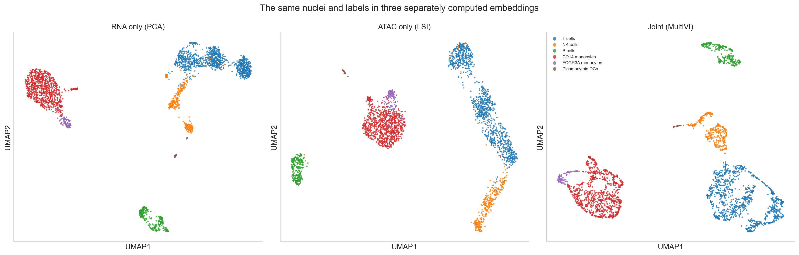

   The same nuclei and labels in three separately computed embeddings. Compare
   which nuclei group together, not positions; the UMAPs are separate
   coordinate systems.

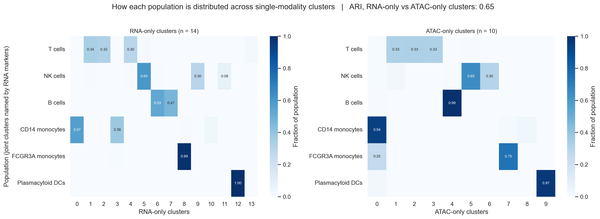

   Fraction of each population in each RNA-only (left) and ATAC-only (right)
   cluster. Values below 0.05 are not printed.

The RNA-only and ATAC-only clusterings agree with each other more than either
agrees with the joint clustering: the adjusted Rand index (ARI) is 0.65 between
them, against 0.58 (joint vs RNA-only) and 0.45 (joint vs ATAC-only). The ARI
is also lowered when one clustering simply has more clusters, and the joint
clustering has the most (17, against 14 and 10).

Where they differ:

* **B cells:** RNA splits them into two clusters (142 and 126 nuclei); chromatin
  keeps 267 of 269 together.
* **FCGR3A monocytes:** RNA keeps 101 of 102 in their own cluster; chromatin
  places 26 of them with CD14 monocytes.
* **NK cells:** both split them into two main groups (RNA 206 and 101;
  chromatin 221 and 104).
* **pDCs:** both keep them in their own cluster (29 of 29 in RNA, 28 of 29 in
  chromatin).

Within T cells, the T-cell state markers show the same three groups in each
measurement: a naive CD4 group (CD4 detected in 29–30% of nuclei and CCR7 in
64%), a naive CD8 group (CD8A in 52–55%, CCR7 in 71%), and a memory CD4 group
(CD4 in 32–34%, CCR7 in 29%). The RNA-only clustering has one more T-cell
cluster, of 27 nuclei with regulatory T-cell markers (section 9).

.. list-table:: T-cell state markers in the RNA-only and ATAC-only clusters (fraction of nuclei with UMIs)
   :header-rows: 1
   :class: wrap-table

   * - Cluster
     - Nuclei
     - CD4
     - CD8A
     - CCR7
     - FOXP3
     - IL2RA
     - RTKN2
   * - RNA 1, naive CD4
     - 365
     - 0.29
     - 0.01
     - 0.64
     - 0.00
     - 0.02
     - 0.02
   * - RNA 2, naive CD8
     - 346
     - 0.02
     - 0.55
     - 0.71
     - 0.00
     - 0.00
     - 0.00
   * - RNA 4, memory CD4
     - 317
     - 0.34
     - 0.03
     - 0.29
     - 0.02
     - 0.16
     - 0.04
   * - RNA 13, regulatory T-like
     - 27
     - 0.19
     - 0.00
     - 0.19
     - 0.41
     - 0.59
     - 0.74
   * - ATAC 3, naive CD4
     - 351
     - 0.30
     - 0.03
     - 0.64
     - 0.00
     - 0.03
     - 0.03
   * - ATAC 1, naive CD8
     - 350
     - 0.02
     - 0.52
     - 0.71
     - 0.00
     - 0.00
     - 0.01
   * - ATAC 2, memory CD4
     - 355
     - 0.32
     - 0.02
     - 0.29
     - 0.05
     - 0.19
     - 0.09

The table counts only nuclei labelled T cells. Detection fractions are low for
some well-known markers, such as CD4, because single-nucleus RNA is sparse.

9. The joint clustering adds divisions that differ in chromatin depth and merges two small groups
----------------------------------------------------------------------------------------------------

The joint clustering has more clusters than either single-measurement
clustering. The marker checks below use observed RNA.

**T-cell divisions.** The joint model splits each of the three T-cell groups
in two, and in each case the two clusters differ in median ATAC fragment count.
Both single-measurement clusterings place most nuclei of each pair in the same
cluster.

* **Naive CD8** (clusters 5 and 11): 11,845 against 7,044 fragments (1.7-fold),
  with similar detection of the T-cell state markers in the panel; the largest
  difference is CD8B (0.66 against 0.52).
* **Naive CD4** (clusters 3 and 13): 11,295 against 8,029 fragments
  (1.4-fold). Cluster 13 also has lower CCR7 detection (0.48 against 0.70) and
  higher IKZF2 (0.16 against 0.03), IL2RA (0.09 against 0.01), and RTKN2 (0.09
  against 0.01), and holds 5 of the 27 regulatory T-like nuclei described
  below.
* **Memory CD4** (clusters 4 and 7): 10,510 against 13,936 fragments
  (1.3-fold). Cluster 7 has lower CCR7 (0.20 against 0.39) and higher GZMK
  (0.10 against 0.01) and CCL5 (0.16 against 0.03), consistent with a more
  effector-like memory state.

The two CD4 divisions are the candidates for states that the joint model
resolves and the single measurements do not. They differ in depth as well as in
markers, and no gene-wide comparison was run for them, so they need
confirmation.

**A candidate doublet cluster.** One joint T-cell cluster of 60 nuclei
includes nuclei with CD4 detected (17%) and nuclei with CD8A detected (37%). It
has the highest median ATAC fragment count of any T-cell cluster (19,640) and
the highest median doublet score among them (0.081). It is a candidate for
residual doublets that Scrublet did not flag.

**A depth split in CD14 monocytes.** The joint model divides CD14 monocytes
into two lower-depth clusters and two higher-depth clusters:

.. list-table:: CD14 monocyte joint clusters (medians)
   :header-rows: 1
   :class: wrap-table

   * - Joint cluster
     - Nuclei
     - ATAC fragments
     - FRiP
     - TSS fraction
     - Mitochondrial UMIs (%)
   * - 0
     - 344
     - 4,183
     - 0.74
     - 0.52
     - 11.8
   * - 1
     - 244
     - 4,224
     - 0.75
     - 0.52
     - 14.7
   * - 6
     - 168
     - 13,739
     - 0.66
     - 0.47
     - 12.1
   * - 8
     - 146
     - 14,281
     - 0.65
     - 0.46
     - 4.0

Neither single-measurement clustering follows this division. The two RNA-only
monocyte clusters each contain lower- and higher-depth nuclei in similar
proportions, and the ATAC-only clustering, whose depth component was dropped,
places 842 of the 864 monocytes compared below in one cluster. Observed RNA
was compared between the lower-depth and higher-depth groups (Wilcoxon test,
mitochondrial genes excluded, DC-like nuclei left out). Only two genes differ
at adjusted p < 0.05, MTRNR2L12 and MTRNR2L8, both higher in the lower-depth
group. They are nuclear copies of the mitochondrial MT-RNR2 gene, and their
share of each nucleus's UMIs correlates with its mitochondrial fraction
(Spearman ρ = 0.63 and 0.37 across the 2,718 nuclei). The groups also differ
in FRiP and TSS fraction (table). Because the evidence is the absence of an
expression difference, we treat this division provisionally as most likely
technical rather than as two monocyte states. Refitting with ATAC depth as a
covariate, or comparing after downsampling fragments, would test whether it
disappears.

**Two small groups merged.** RNA-only cluster 10 holds 38 nuclei with
conventional DC markers (FCER1A and CD1C detected in 76% of them, CLEC10A in
74%). ATAC-only cluster 8 contains 32 of these 38 nuclei, and they make up 86%
of it. The joint clustering places all 38 in joint cluster 6, where they make
up 23% of a cluster labelled CD14 monocytes. Likewise, the 27 nuclei of the
RNA-only regulatory T-like cluster are spread over joint CD4 T-cell clusters;
the ATAC-only clustering does not separate them either. Raising the joint
clustering resolution from 0.8 to 3.0 (17 to 41 clusters) changes this only
partly. From resolution 1.6 upward, all 38 DC-like nuclei share one joint
cluster, but they make up only about half of it (52–54%). The regulatory T-like
nuclei never make up more than 34% of a joint cluster. In the joint
representation, these small groups sit close to their larger neighbors.

.. code-block:: python

   depth_group = split_population_by_depth(container.obs, "CD14 monocytes")
   monocyte_de = compare_rna_groups(rna_paired, monocyte_groups)
   small_groups = small_group_masks(container.obs, dc_tables["leiden_rna"], t_states_rna)
   resolution_check(container, small_groups, [0.8, 1.2, 1.6, 2.0, 3.0])

**The monocyte split and the merges recur across training seeds; the joint
clusters do not.** ``scripts/seed_check.py`` retrained the same model input
with three other seeds (23, 42, and 101; 215 to 353 epochs) and clustered each
with the same graph settings. The joint clusters change between seeds: 17 to 20
clusters, with ARI 0.44 to 0.66 against the main run. The following recur in
all four seeds:

* CD14 monocytes fall into four or five joint clusters of at least 50 nuclei,
  whose median fragment counts span 3.4- to 4.2-fold.
* At resolution 0.8, the DC-like nuclei make up at most 27% of any joint
  cluster, and the regulatory T-like nuclei at most 19%.
* The joint clustering agrees less with each single-measurement clustering (ARI
  0.36 to 0.58 with RNA-only, 0.31 to 0.45 with ATAC-only) than those two agree
  with each other (0.65).

Individual joint clusters, such as the T-cell divisions, should therefore not
be reported from a single training run.

.. code-block:: bash

   python scripts/seed_check.py --seed 23
   python scripts/seed_check.py --seed 42
   python scripts/seed_check.py --seed 101
   python scripts/seed_check.py --combine

Going further
-------------

**Which peaks distinguish a cluster.** The :doc:`scATAC tutorial
<../epigenomics/scatac>` calls candidate cluster-associated peaks with
PEAKVI's ``differential_accessibility`` and explains how to read its posterior
expected FDR and effect sizes. MultiVI offers the same call on the joint model
(``model.differential_accessibility``), and ``model.differential_expression``
for genes. Before comparing joint clusters from this tutorial, check that they
do not differ mainly in ATAC depth (section 9). A comparison between the two
CD14 monocyte depth groups, for example, would be confounded with depth.

**Several samples or technologies.** This sample has one donor and one
library, so no ``batch_key`` is used. The MultiVI paper (Ashuach et al. 2023,
"Integration of independent studies") combined three PBMC studies: paired
multiome, ATAC-only from several batches, and RNA-only from several
technologies. Run without accounting for study or technology, its latent space
separated cells by sample in the accessibility data and by technology in the
expression data. The paper reports that configuring MultiVI to correct for both
removed this structure while preserving cell types. With several samples,
follow the ``batch_key`` guidance in section 5, then check the joint clusters
against sample, depth, and markers as done here.

Stopping point and limitations
------------------------------

The output is a QC-audited paired object, an RNA-only, an ATAC-only, and a
joint representation of the same nuclei, provisional broad labels, and a
record of where the three representations agree and differ. Per-nucleus
identity columns (``cell_id``, ``modality_status``, ``has_rna``, ``has_atac``)
and per-modality QC flags are saved with the results, so the same nuclei can be
used in an analysis that hides one measurement and checks predictions against
it.

This dataset contains one donor. It supports QC, representation learning, and
descriptive comparisons within this sample. It cannot estimate donor or
condition effects, and nuclei are not independent biological replicates.
Ambient RNA was not assessed. Common ambient-RNA methods estimate the
background from the raw matrix with its empty droplets, which this tutorial
does not download.

Common pitfalls
---------------

* Applying one QC rule to both measurements, or filtering a nucleus out because
  one measurement failed when the other is usable.
* Passing normalized or log-transformed matrices to MultiVI instead of counts.
* Selecting features after which a paired nucleus has zero counts in a
  modality, so that MultiVI treats it as unmeasured.
* Including mitochondrial-derived genes in the modeled genes of nuclear RNA.
* Reading the joint UMAP as more trustworthy than single-measurement views
  without checking its clusters against depth and markers.
* Assuming that small populations visible in one measurement survive in the
  joint clustering.
* Treating promoter accessibility as evidence that a peak regulates the nearest
  gene.
* Calling clusters cell types without marker evidence, or treating cluster
  markers as condition-level inference.

References
----------

* Ashuach T, Gabitto MI, Koodli RV, Saldi GA, Jordan MI, Yosef N. MultiVI: deep
  generative model for the integration of multimodal data. *Nature Methods*
  2023. `doi:10.1038/s41592-023-01909-9
  <https://doi.org/10.1038/s41592-023-01909-9>`_.
* Gayoso A and colleagues. A Python library for probabilistic analysis of
  single-cell omics data. *Nature Biotechnology* 2022.
  `doi:10.1038/s41587-021-01206-w
  <https://doi.org/10.1038/s41587-021-01206-w>`_.
* Bredikhin D, Kats I, Stegle O. MUON: multimodal omics analysis framework.
  *Genome Biology* 2022. `doi:10.1186/s13059-021-02577-8
  <https://doi.org/10.1186/s13059-021-02577-8>`_.
* Wolock SL, Lopez R, Klein AM. Scrublet: computational identification of cell
  doublets in single-cell transcriptomic data. *Cell Systems* 2019.
  `doi:10.1016/j.cels.2018.11.005 <https://doi.org/10.1016/j.cels.2018.11.005>`_.
* Wolf FA, Angerer P, Theis FJ. SCANPY: large-scale single-cell gene expression
  data analysis. *Genome Biology* 2018. `doi:10.1186/s13059-017-1382-0
  <https://doi.org/10.1186/s13059-017-1382-0>`_.
* 10x Genomics. PBMC from a healthy donor, no cell sorting (3k), Cell Ranger
  ARC 2.0.0.
